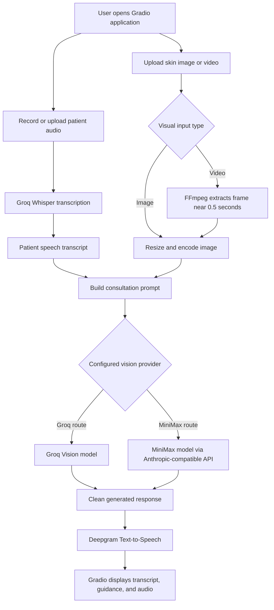

# AI Skin Specialist

**A multimodal AI skincare consultation prototype powered by voice transcription, image analysis, and generated speech.**

AI Skin Specialist is a Gradio-based application that accepts a spoken description of a skin concern together with a skin image or video. It transcribes the patient's audio, combines the transcript with visual input for LLM-based guidance, and converts the generated response into audio.

The project demonstrates how speech, vision-language models, API integrations, media preprocessing, and a web interface can be connected into one end-to-end AI workflow.

> **Important:** This is an experimental AI application for educational and demonstration purposes. It is not a medical device and does not provide a diagnosis, treatment plan, or substitute for a licensed dermatologist or other qualified healthcare professional.

---

## Table of Contents

- [Project Overview](#project-overview)
- [Key Features](#key-features)
- [Technology Stack](#technology-stack)
- [System Architecture](#system-architecture)
- [How the Workflow Operates](#how-the-workflow-operates)
- [AI Providers and Model Configuration](#ai-providers-and-model-configuration)
- [Repository Structure](#repository-structure)
- [Prerequisites](#prerequisites)
- [Setup and Installation](#setup-and-installation)
- [Environment Configuration](#environment-configuration)
- [Run the Application](#run-the-application)
- [How to Use](#how-to-use)
- [Sample Assets](#sample-assets)
- [Data Handling and Privacy Considerations](#data-handling-and-privacy-considerations)
- [Current Limitations](#current-limitations)
- [Troubleshooting](#troubleshooting)
- [Roadmap](#roadmap)
- [Testing](#testing)
- [Contributing](#contributing)
- [License](#license)

---

## Project Overview

Traditional digital consultation interfaces often separate voice input, image upload, AI analysis, and spoken responses into different tools. AI Skin Specialist brings these steps together in a single interface.

A user can:

1. Record a voice description or upload an audio file explaining a skin concern.
2. Upload a skin image or a short video of the affected area.
3. Submit the inputs for processing.
4. View the recognized speech transcript and the generated written guidance.
5. Listen to the generated audio response.

The application uses external AI services for transcription, visual-language processing, and speech generation. It is a prototype demonstrating multimodal AI integration, not a clinically validated dermatology system.

## Key Features

| Feature | Description | Implementation |
|---|---|---|
| Voice input | Record audio through the browser or upload an existing audio file. | Gradio Audio component |
| Speech-to-text | Convert the spoken description into text. | Groq API with a Whisper model |
| Image input | Upload a skin image for visual context. | Gradio Image component |
| Image preprocessing | Resize large images and encode them as JPEG before sending them to a vision model. | Pillow, Base64 |
| Video input | Upload a short video of the affected area. | Gradio Video component and FFmpeg frame extraction |
| AI-generated guidance | Combine the transcribed concern with available visual input to generate a short response. | Groq Vision or MiniMax, depending on configuration |
| Text-to-speech | Convert the generated response into an audio file. | Deepgram Text-to-Speech |
| Consultation interface | Display the transcript, written guidance, and playable audio response. | Gradio with custom CSS |

## Technology Stack

| Layer | Technology | Purpose |
|---|---|---|
| Language | Python | Application logic and API integration |
| Web interface | Gradio | Browser-based consultation workflow |
| Speech recognition | Groq API / Whisper | Patient audio transcription |
| Vision-language processing | Groq Vision or MiniMax | Text-and-image based response generation |
| Text-to-speech | Deepgram SDK | Generate spoken responses |
| Image processing | Pillow | Image conversion, resizing, and compression |
| Audio processing | SpeechRecognition, PyDub, SoundDevice | Audio data handling and microphone helper functions |
| Video processing | FFmpeg | Extract a representative frame from uploaded video |
| Configuration | python-dotenv | Load API keys and model settings from `.env` |
| Dependency management | uv / pip | Python environment and package management |

---

## System Architecture

The application is organized around a linear multimodal processing pipeline rather than a multi-agent system.



### Main Components

**1. Gradio interface — `main.py`**

- Defines the browser-based application layout.
- Accepts microphone recordings or uploaded audio files.
- Accepts either an image or a video as visual input.
- Calls the processing function when the user selects **Analyze Concern**.
- Displays the speech transcript, generated guidance, and audio response.

**2. Consultation and vision logic — `brain.py`**

- Loads API configuration from environment variables.
- Prepares images for model input by converting them to RGB, resizing them to fit within a 1024 × 1024 bounding box, and encoding them as JPEG.
- Extracts a representative frame from video using FFmpeg.
- Selects the configured vision-language provider.
- Builds a short natural-language prompt and cleans the generated response for speech output.

**3. Patient speech processing — `patient_voice.py`**

- Provides a `transcribe_patient_voice()` function that sends the supplied audio file to Groq for transcription.
- Uses the configured Whisper model, defaulting to `whisper-large-v3`.
- Also contains a standalone microphone recording helper based on SoundDevice, with ambient-noise calibration and silence detection. The Gradio application's browser audio component handles recording in the main application flow.

**4. Speech generation — `voice.py`**

- Sends the generated text to Deepgram Text-to-Speech.
- Saves the generated audio as an MP3 file.
- Uses a unique output filename to reduce file-lock conflicts, especially on Windows.

**5. Legacy audio helper — `patient_que.py`**

- Contains an alternate microphone-recording and transcription example.
- It is not imported by the current `main.py` application flow. Treat it as a standalone/legacy helper until the project consolidates its audio implementation.

---

## How the Workflow Operates

### Step 1 — Capture the patient's concern

The Gradio interface accepts an audio recording from the browser microphone or an audio file upload. It also requires a skin image or video before analysis can begin.

### Step 2 — Transcribe the audio

`patient_voice.py` sends the audio file to Groq's transcription API. The returned text is shown in the **Your Speech Transcript** field and is passed to the consultation logic.

### Step 3 — Prepare visual input

- **Image input:** `brain.py` converts the image to RGB, constrains its maximum dimensions to 1024 × 1024, saves it as an optimized JPEG in memory, and Base64-encodes it for the model request.
- **Video input:** The current implementation attempts to use FFmpeg to extract one frame at approximately 0.5 seconds. This is a representative still image, not a multi-frame video-understanding pipeline.
- **Both supplied:** The current logic gives the image input priority over the video input.

### Step 4 — Generate written guidance

The transcript and prepared visual input are sent to the selected vision-language provider. The prompt requests a brief response of no more than two or three sentences. The response is cleaned to remove common Markdown formatting before it is passed to speech synthesis.

### Step 5 — Generate the spoken response

`voice.py` sends the response text to Deepgram Text-to-Speech and writes the returned audio chunks to an MP3 file.

### Step 6 — Display the consultation result

The Gradio interface displays:

- The recognized patient speech transcript.
- The AI-generated written guidance.
- The generated doctor-style voice response, available through an audio player.

---

## AI Providers and Model Configuration

The current implementation uses different services for different stages.

| Stage | Provider | Default model / setting | Environment variable |
|---|---|---|---|
| Speech-to-text | Groq | `whisper-large-v3` | `GROQ_API_KEY`, `WHISPER_MODEL` |
| Visual guidance | Groq | `qwen/qwen3.8-27b` in the current code | `GROQ_API_KEY`, `GROQ_VISION_MODEL` |
| Visual guidance | MiniMax through its Anthropic-compatible API | `MiniMax-M3` | `MINIMAX_API_KEY`, `MINIMAX_BASE_URL`, `MINIMAX_MODEL` |
| Text-to-speech | Deepgram | `aura-2-thalia-en` | `DEEPGRAM_API_KEY`, `DEEPGRAM_TTS_MODEL` |

### Vision provider selection

The current provider-selection logic in `brain.py` behaves as follows:

- Groq Vision is selected when a Groq API key is available and no MiniMax key is configured.
- When both Groq and MiniMax keys are configured, MiniMax is selected by default.
- Set `VISION_PROVIDER=groq` to explicitly select Groq Vision when both keys are configured.

Groq is also used for speech transcription, so `GROQ_API_KEY` is required for the complete application workflow regardless of which visual guidance provider is selected.

> Model identifiers and API availability can change. Confirm that the model configured in your account is currently supported by the corresponding provider before running the application.

---

## Repository Structure

The following structure reflects the files currently present in the repository.

```text
sceencare_assistant-/
│
├── src/
│   └── medicare_assistant/
│       └── __init__.py       # Placeholder package entry point
│
├── .env.example              # Environment-variable template
├── .gitignore                # Ignores secrets, virtual environments, and generated audio
├── README.md                 # Project documentation
├── brain.py                  # Image/video preparation and vision-language analysis
├── main.py                   # Gradio application and workflow orchestration
├── patient_que.py            # Legacy/standalone audio helper
├── patient_voice.py          # Audio recording helper and Groq transcription
├── pyproject.toml            # Project metadata and dependencies
├── sample-image.png          # Sample image asset
├── test-video.mp4            # Sample video asset
├── uv.lock                   # Locked Python dependency resolution
└── voice.py                  # Deepgram text-to-speech integration
```

**Entry-point note:** The current `pyproject.toml` defines a `medicare-assistant` console command, but `src/medicare_assistant/__init__.py` currently contains only a placeholder function that prints a greeting. Launch the actual Gradio application with `python main.py` (or `uv run python main.py`), not with the `medicare-assistant` command.

---

## Prerequisites

Before running the application, make sure the following are available:

- **Python 3.14 or later** — this is the minimum version currently declared in `pyproject.toml`.
- **uv** (recommended) or pip.
- **FFmpeg** — required when using video input. It is also used by the standalone audio-recording helper when exporting MP3 files. FFmpeg must be available on your system `PATH` for those paths.
- **Microphone access** — only if recording audio from the browser or using the standalone SoundDevice recording helper.
- **API credentials** — Groq and Deepgram are required for the complete default workflow; MiniMax is required when using the MiniMax vision route.

Verify FFmpeg is available:

```bash
ffmpeg -version
```

### Dependency correction required before running

The current `patient_voice.py` imports `sounddevice`, but `sounddevice` is not declared in the committed `pyproject.toml` or `uv.lock`. `numpy` is present transitively through another dependency, but it is used directly by `patient_voice.py` and should be declared explicitly.

Add both as direct project dependencies before syncing the environment:

```bash
uv add numpy sounddevice
uv sync
```

With pip, install them explicitly after installing the project:

```bash
python -m pip install -e .
python -m pip install numpy sounddevice
```

This documents a dependency gap in the current repository; the dependency files should be updated and committed so that new installations do not need this extra manual step.

---

## Setup and Installation

### 1. Clone the repository

```bash
git clone https://github.com/harmitprajapati2006/sceencare_assistant-.git
cd sceencare_assistant-
```

### 2. Create a virtual environment

#### Recommended: uv

```bash
uv python install 3.14
uv venv --python 3.14
```

Activate it if you prefer an activated shell.

**Windows PowerShell:**

```powershell
.\.venv\Scripts\Activate.ps1
```

**macOS / Linux:**

```bash
source .venv/bin/activate
```

#### Alternative: standard venv and pip

**Windows PowerShell:**

```powershell
py -3.14 -m venv .venv
.\.venv\Scripts\Activate.ps1
```

**macOS / Linux:**

```bash
python3.14 -m venv .venv
source .venv/bin/activate
```

### 3. Install Python dependencies

**Using uv:**

```bash
uv add numpy sounddevice
uv sync
```

**Using pip:**

```bash
python -m pip install --upgrade pip
python -m pip install -e .
python -m pip install numpy sounddevice
```

### 4. Install FFmpeg

Install FFmpeg using the official instructions or a trusted package manager for your operating system. Make sure the `ffmpeg` executable is available on `PATH`, then verify it with `ffmpeg -version`. For image-only consultation through the Gradio UI, FFmpeg is not needed for frame extraction; video input requires it. SoundDevice may also require a working PortAudio runtime on some operating systems.

### 5. Configure API credentials

Copy the example environment file:

**Windows PowerShell:**

```powershell
Copy-Item .env.example .env
```

**macOS / Linux:**

```bash
cp .env.example .env
```

Edit `.env` and add the required API keys and optional model settings.

---

## Environment Configuration

The repository includes an `.env.example` file with the following settings:

```env
# Required for speech transcription
GROQ_API_KEY=""

# Required for generated voice responses
DEEPGRAM_API_KEY=""

# Required when using MiniMax for visual guidance
MINIMAX_API_KEY=""
MINIMAX_BASE_URL="https://api.minimax.io/anthropic"
MINIMAX_MODEL="MiniMax-M3"

# Optional model settings
DEEPGRAM_TTS_MODEL="aura-2-thalia-en"
WHISPER_MODEL="whisper-large-v3"
```

The following optional variables are read by the current code but are not included in the committed `.env.example` yet:

```env
# Add this only when you want Groq Vision while both provider keys are configured
VISION_PROVIDER="groq"

# Optional override for the Groq vision model
GROQ_VISION_MODEL="qwen/qwen3.8-27b"
```

### Which keys do I need?

| Configuration | Required? | Explanation |
|---|---|---|
| `GROQ_API_KEY` | Yes | Used for Whisper transcription and, depending on configuration, Groq Vision. |
| `DEEPGRAM_API_KEY` | Yes | Used to generate the spoken response. The current UI workflow treats TTS failure as a processing error. |
| `MINIMAX_API_KEY` | Conditional | Needed when MiniMax is selected for visual guidance. Not needed when using Groq Vision. |
| `MINIMAX_BASE_URL` | Optional | MiniMax Anthropic-compatible API endpoint; the code has a default. |
| `MINIMAX_MODEL` | Optional | MiniMax model identifier; the code has a default. |
| `WHISPER_MODEL` | Optional | Groq transcription model; defaults to `whisper-large-v3`. |
| `DEEPGRAM_TTS_MODEL` | Optional | Deepgram speech model; defaults to `aura-2-thalia-en`. |
| `VISION_PROVIDER` | Optional | Set to `groq` to select Groq Vision when both Groq and MiniMax keys are set. |
| `GROQ_VISION_MODEL` | Optional | Overrides the Groq vision model identifier. |

**Never commit your `.env` file or paste API keys into issues, screenshots, or public documentation.** The repository's `.gitignore` is configured to exclude `.env` files while retaining `.env.example`.

---

## Run the Application

From the repository root, start the Gradio application:

**Using uv:**

```bash
uv run python main.py
```

**Using an activated virtual environment:**

```bash
python main.py
```

When the application starts successfully, Gradio prints a local URL in the terminal. Open that URL in your browser. The default local address is typically:

```text
http://127.0.0.1:7860
```

The current entry point launches Gradio with `debug=True`, which is appropriate only for local development. Review the deployment and security notes before exposing the application to other users.

---

## How to Use

1. Start the application and open the local Gradio URL.
2. In **Patient Input**, record a voice description using the microphone or upload an audio file.
3. Upload a skin image or a short skin video. The current application requires at least one visual input.
4. Select **Analyze Concern**.
5. Wait for the audio transcription, model response, and speech generation stages to complete.
6. Review **Your Speech Transcript** and **Doctor's Guidance**.
7. Play the generated **Doctor Voice Response** in the audio player.

For clearer visual input, use a well-lit image or a short video with the affected area visible. Do not use real patient information unless you have the required consent and have reviewed the data-processing implications described below.

---

## Sample Assets

The repository currently includes two sample media files:

- [`sample-image.png`](./sample-image.png)
- [`test-video.mp4`](./test-video.mp4)

These can be used as local reference inputs while testing the upload workflow. Before distributing the repository or using these assets in a public demo, verify that you have the right to share them and that they do not contain identifiable or sensitive patient information.

---

## Data Handling and Privacy Considerations

This application uses external providers to process user-submitted content. Based on the current code path:

- Audio is sent to **Groq** for speech transcription.
- The transcript and prepared visual input are sent to the configured **Groq Vision or MiniMax** provider for response generation.
- Generated response text is sent to **Deepgram** for text-to-speech generation.
- Uploaded media may be handled by the Gradio runtime as temporary files, and generated MP3 responses are written to the project directory.

The project does not currently include a complete privacy policy, consent flow, authentication layer, or provider-independent data-retention controls. Do not describe the application as privacy-preserving or suitable for protected health information without implementing and validating the required safeguards.

Before using this application with real people:

- Obtain clear consent for audio, image, and video processing.
- Review the privacy, retention, and data-use terms of each API provider.
- Avoid sending names, faces, contact details, medical records, or other identifying information unless the deployment has been assessed for the applicable legal and security requirements.
- Use synthetic or consented sample data for demonstrations and testing.
- Add authentication, access controls, secure transport, and a documented deletion/retention process before any non-local deployment.

---

## Current Limitations

The following limitations reflect the current repository implementation and should be considered before presenting the project as a production healthcare application.

1. **Not a diagnostic system:** The response is generated by an LLM prompt and has not been clinically validated. It must not be used to diagnose, prescribe, or determine treatment.
2. **Single-frame video handling:** The normal video path extracts one frame near 0.5 seconds. It does not analyze motion or changes across the full video.
3. **External API dependency:** Transcription, visual guidance, and voice generation depend on external API credentials, provider availability, network access, and model support.
4. **No clinical evaluation dataset:** The repository does not provide a validated medical benchmark or measured clinical accuracy.
5. **No automated test suite currently visible:** The repository does not currently expose a dedicated automated test directory or test workflow.
6. **Development-mode launch:** The application uses `debug=True` and does not currently implement user authentication or production deployment controls.
7. **Dependency metadata needs correction:** `sounddevice` is imported but is not declared in the current project dependency manifest. `numpy` should also be declared directly because it is imported by the audio module.
8. **Placeholder console script:** The registered `medicare-assistant` command is not connected to the Gradio application; use `main.py` to launch the app.
9. **Provider configuration is partly undocumented in the template:** `VISION_PROVIDER` and `GROQ_VISION_MODEL` are read by the code but are not currently listed in `.env.example`.

---

## Troubleshooting

| Problem | Likely cause | Suggested action |
|---|---|---|
| `ModuleNotFoundError: No module named 'sounddevice'` | Missing direct dependency | Install with `uv add sounddevice` or `python -m pip install sounddevice`, then restart the app. |
| `ModuleNotFoundError: No module named 'numpy'` | Missing or inconsistent Python environment | Install with `uv add numpy` or `python -m pip install numpy`. |
| FFmpeg command not found | FFmpeg is not installed or not on `PATH` | Install FFmpeg, add its executable directory to `PATH`, and verify with `ffmpeg -version`. |
| Groq authentication/transcription error | Missing or invalid `GROQ_API_KEY` | Check `.env`, key validity, and provider account access. |
| MiniMax analysis error | MiniMax credentials, endpoint, or model configuration is invalid | Verify `MINIMAX_API_KEY`, `MINIMAX_BASE_URL`, and `MINIMAX_MODEL`. |
| Deepgram audio generation error | Missing or invalid `DEEPGRAM_API_KEY` | Verify the key and the configured TTS model. |
| Browser microphone does not work | Browser permission, input device, or operating-system privacy setting | Allow microphone access and confirm the correct input device is enabled. |
| Application starts but analysis fails | A stage in the external API workflow may have failed | Read the terminal output and verify all required keys, network access, provider quotas, and model availability. |
| `medicare-assistant` prints a greeting instead of launching the UI | The current console-script target is a placeholder | Run `python main.py`; repair the console entry point separately. |

---

## Roadmap

Potential improvements for future versions:

- [ ] Declare and lock all direct runtime dependencies, including `numpy` and `sounddevice`.
- [ ] Replace the placeholder console entry point with a real application entry point or remove the unused script.
- [ ] Add an explicit provider selector and validate provider/model combinations at startup.
- [ ] Add multi-frame video sampling and a documented video analysis strategy.
- [ ] Improve response handling with clear uncertainty language and escalation guidance for urgent symptoms.
- [ ] Add tests for image preprocessing, video frame extraction, provider routing, transcription, and TTS error handling.
- [ ] Add structured logging and clearer per-stage timing/error reporting.
- [ ] Replace `debug=True` with configurable development and production modes.
- [ ] Add authentication, consent, data-retention, and deletion controls before any public deployment.
- [ ] Add a real application screenshot and short end-to-end demo recording.

---

## Testing

No dedicated automated test suite is currently visible in the repository. The application should be manually validated in a local environment after correcting the missing `sounddevice` dependency and configuring API credentials.

A useful validation checklist is:

- [ ] Application starts and loads the Gradio interface.
- [ ] Audio upload produces a non-empty transcript.
- [ ] Browser microphone recording works with permission granted.
- [ ] Image preprocessing handles RGB, grayscale, and transparent images.
- [ ] Video input successfully extracts a frame when FFmpeg is available.
- [ ] Groq Vision provider path returns a response.
- [ ] MiniMax provider path returns a response.
- [ ] Deepgram generates a playable MP3 response.
- [ ] Missing API keys and provider failures produce understandable errors.
- [ ] Temporary and generated media files are handled as intended.

Do not report test coverage, accuracy, latency, or reliability metrics until they have been measured and documented.

---

## Contributing

Contributions that improve the code quality, documentation, test coverage, accessibility, and safety of this prototype are welcome.

Before submitting a change:

1. Explain the problem or improvement.
2. Keep API keys and personal data out of commits.
3. Test the affected workflow locally.
4. Update the README when behavior, dependencies, or environment variables change.

A formal open-source contribution and redistribution policy should be added after the project owner selects and adds a license.

## License

No `LICENSE` file is currently present in the repository. Until a license is added, the repository does not explicitly grant permission for reuse, modification, or redistribution. Add a license only after confirming that the project owner has the rights to license the code and any bundled assets.

---

**Built by Harmit Prajapati**  
[GitHub Repository](https://github.com/harmitprajapati2006/sceencare_assistant-)
